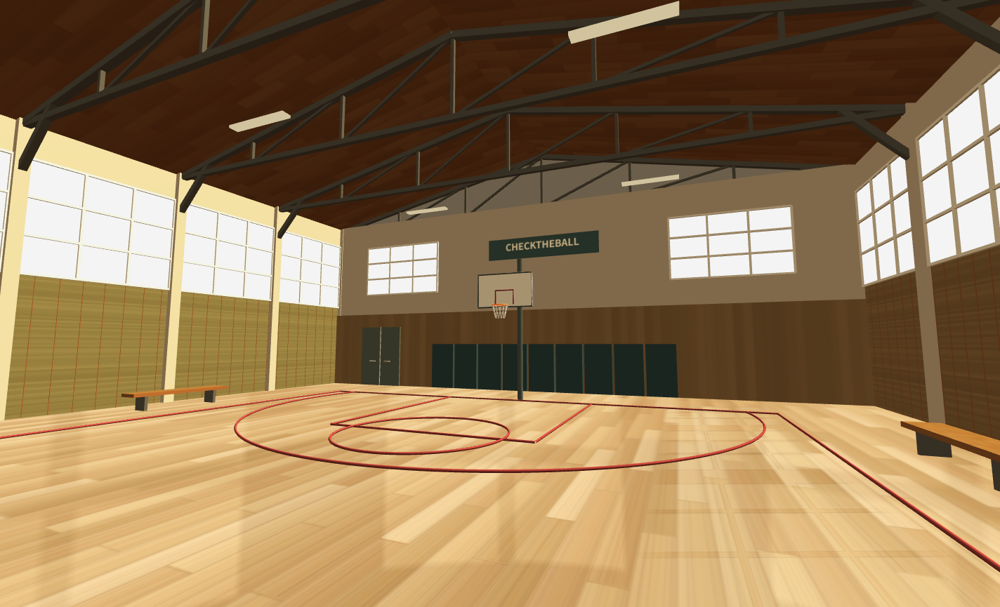

# 실내 체육관 외형

참고 이미지의 따뜻한 목재 마루, 버건디 라인, 높은 격자창, 목재 천장과 철골 트러스를
기본 도형과 한 번 생성하는 Canvas 텍스처로 표현했다. 참고 이미지를 텍스처로 사용하거나
외부 사진/모델/라이브러리를 추가하지 않았다.

- 외형과 조명 설정: `apps/web/game/createIndoorGym.ts`의 `GYM`.
- 체육관 외형 21×23m, 처마 7.6m, 용마루 9.8m. 플레이 영역은 기존 반코트 그대로다.
- 공통 `COURT.floorY` 사용. 림 `(0,3.05,5.7)`, 백보드 `(0,3.55,6.1)`과 크기 유지.
- 경계/아크/자유투 라인 좌표, 충돌·이동·슛·득점·온라인 규칙 변경 없음.
- 야외 펜스·건물·가로등 제거. 벽 패널·창문·트러스·조명·벤치·브랜드 표지 추가.
- 실내 벽/창문/기둥은 이름표 가림 대상에 연결. 시각 벽을 게임 물리 충돌체로 추가하지 않았다.
- 목재/창밖/반사/햇빛 텍스처는 Scene 생성 시 한 번 생성한다. 정적 프레임과 트러스를 병합한다.
- 반사는 정적 환경 텍스처, 바닥 햇빛은 고정 투영 도형이다. 움직이는 인물의 실시간 반사나
  창틀/캐릭터의 동적 그림자, 사진 수준의 전역 조명은 구현하지 않았다.

`node scripts/probe-indoor-gym.mjs`는 실제 createGame 환경을 별도 카메라 각도로 보여주며
캐릭터/공/더미 마커를 숨긴 건축 미리보기 한 장을 위 파일에 저장한다. 게임 카메라 설정을
바꾸는 옵션은 아니다. 이번 작업에서는 초기/최종 미리보기 총 두 장만 촬영하고 최종 파일로
덮어썼다. 브라우저 예외와 골대 좌표를 확인했으며 프레임 시간/성능 비교는 측정하지 않았다.

사용자 확인 순서: 혼자 연습 입장 → 바닥/천장/양쪽 창문 확인 → 골대와 공이 잘 보이는지 확인 →
슛/패스/더미 왕복 → 온라인 두 창에서 동일 외형과 닉네임 가림 확인.
타입 검사는 실행했으며 전체 테스트·빌드·온라인 실기는 이번 외형 변경에서 실행하지 않았다.
